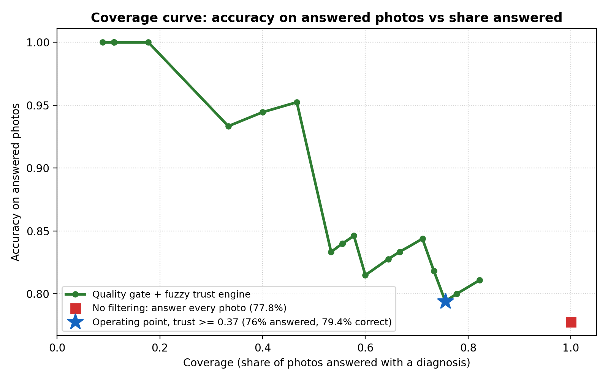

# PlantDoc: Leaf Doctor for Real Field Photos 🌿

**NexAI Hack 2026** | **Track 2:** Smart Manufacturing & Computer Vision | **Problem Statement:** 2.2 (Agriculture)

[](https://huggingface.co/spaces/rohithkrishnaak/PlantDoc)
[](https://github.com/rohithkrishnaak/PlantDoc)
[](./MLFLOW_GUIDE.md)

---

## 📖 Problem Statement and Solution Overview

### The Problem
Plant diseases destroy up to 40% of Indian farmers' harvest, with early detection severely hindered by the lack of local agronomists. While standard AI models achieve ~99% accuracy on sterile lab photos (e.g., PlantVillage), they fail drastically on real smartphone photos taken in fields under variable sunlight, motion blur, and background soil clutter. Crucially, standard classifiers emit **dangerously confident false predictions**, causing farmers to purchase and spray the wrong chemical pesticides.

### Our Solution
**PlantDoc** is a mobile-first field diagnostic assistant that is honest about what it does not know. A photo passes four checks before any diagnosis is shown:
1. **OpenCV Image Quality Gate**: Laplacian variance plus a directional-gradient check (defocus and motion blur), HSV brightness (dark / glare), and leaf coverage (green tissue plus lesions next to it, so bare soil is not counted as leaf). Each feature feeds a fuzzy inference system. Unusable photos are rejected with a specific retake tip (*"move closer"*, *"avoid shadows"*, *"hold steady"*).
2. **Hybrid CNN + Transformer Classifier**: CLAHE contrast normalisation, then fused features from two frozen ImageNet-pretrained backbones (**ConvNeXt-T** + **DINOv2 ViT-S/14**) with a class-balanced linear head. It is trained on real, internet-sourced field photos from the IIT PlantDoc dataset (CC BY 4.0), not PlantVillage lab photos.
3. **"Not a supported leaf" check**: if a photo's features are far from every training photo (a face, a wall, an unsupported crop), the app says so instead of forcing one of the 6 classes.
4. **Mamdani Fuzzy Trust Engine**: combines image quality and model confidence. Below the trust threshold, which was chosen on training-set cross-validation (never on the test set), the app answers **`"Not sure, please consult an agricultural expert."`**
5. **Grad-CAM Explainability (Stretch Goal 1)**: a heatmap of the leaf regions that drove the prediction (from the ConvNeXt branch).
6. **Multilingual Interface (Stretch Goal 2)**: English, Hindi (हिन्दी) and Tamil (தமிழ்).
7. **ICAR / TNAU Care Notes (Stretch Goal 3)**: organic and chemical management advice cited from agricultural extension sources.
8. **Expert Advisor and accounts**: a rule-based action plan (urgency, doses scaled to your acres, spray calendar, prevention, safety, expert escalation) that updates with field conditions, plus optional sign-in with profile and diagnosis history.

---

## 🏗️ Architecture & Pipeline Flow

```
[Phone camera / upload]  (JPG, PNG, WEBP, HEIC; EXIF rotation fixed)
         │
         ▼
[Image Quality Gate]  blur · motion blur · brightness · leaf coverage ──► fuzzy quality score
         ├── score < 0.50 ──► ❌ Rejected + specific retake tip
         ▼
[CLAHE ► ConvNeXt-T ⊕ DINOv2 ViT-S]  frozen features, fused ──► linear head ──► top-3 probabilities
         ├── far from all training photos ──► ❌ "Does not look like a supported tomato/potato leaf"
         ▼
[Mamdani Fuzzy Trust Engine]  quality score × model confidence ──► trust score
         ├── trust < 0.61 ──► ⚠️ "Not sure, please consult an agricultural expert."
         ▼
[Trusted diagnosis]  top-3 bars · Grad-CAM heatmap · ICAR/TNAU care note · EN / हिंदी / தமிழ்
         ▼
[Expert Advisor]  urgency · doses for your acres · spray calendar · safety · KVK escalation
```

**Technology stack:** Python, PyTorch + `timm` (ConvNeXt-T, DINOv2 ViT-S/14), OpenCV, scikit-fuzzy, scikit-learn, MLflow, FastAPI, Hugging Face Spaces.

---

## 📊 Evaluation & Coverage Curve Results

**Test set:** the PlantDoc test split for our 6 classes, **after removing 7 test photos that also appear in training** (5 exact copies, 2 near-copies; see *Data integrity* below). That leaves 45 held-out photos. Every decision (backbones, CLAHE, regularisation, trust threshold, out-of-distribution threshold) was made with grouped 5-fold cross-validation on the training split; the test set was used once.

| Metric (45 held-out photos) | Result | 95% CI |
|---|---|---|
| **Top-1 accuracy** (every photo, no filtering) | **66.7%** | 51–80% |
| **Top-3 accuracy** | **97.8%** | 93–100% |
| Quality-gate pass rate on real test photos | 84.4% | |
| Real leaves wrongly flagged "not a supported leaf" | 0 / 45 | |
| Photos answered with a diagnosis (trusted) | 42.2% (19/45) | |
| **Accuracy on answered photos** | **89.5%** (17/19) | 74–100% |

Cross-validation on the training split agrees: 66.5% top-1 out-of-fold, against 52.0% for a frozen EfficientNet-B0 and 38.5% on the test set for the original fine-tuned EfficientNet-B0.

**Per-class results (all 45 test photos)**

| Class | Precision | Recall | F1 | n |
|---|---|---|---|---|
| Potato Early Blight | 0.57 | 0.67 | 0.62 | 6 |
| Potato Late Blight | 0.80 | 0.80 | 0.80 | 5 |
| Tomato Bacterial Spot | 0.58 | 0.88 | 0.70 | 8 |
| Tomato Early Blight | 0.62 | 0.56 | 0.59 | 9 |
| Tomato Healthy | 0.83 | 0.62 | 0.71 | 8 |
| Tomato Late Blight | 0.71 | 0.56 | 0.62 | 9 |

The most common confusion is Tomato Healthy predicted as Bacterial Spot (3 photos); see `confusion_matrix.png`.

### Coverage curve


The fewer photos the app answers, the more accurate the answers: 66.7% when answering everything, 89.5% at the chosen threshold (42% answered). Wrong-pesticide risk drops because ambiguous photos go to "not sure" instead.

### Does the quality gate catch bad photos?
We degraded the 38 clean test photos that pass the gate and re-checked them (`experiments/quality_gate_eval.py`):

| Degradation | Rejected | Main tip shown |
|---|---|---|
| Defocus blur | 97% | hold steady / tap to focus |
| Motion blur | 79% | hold steady / tap to focus |
| Too dark | 100% | move into daylight |
| Glare / overexposed | 97% | avoid glare |
| Leaf too small (on soil) | 100% | move closer |

### Data integrity
PlantDoc is scraped from the internet, so copies repeat. `src/dedup.py` (MD5 plus perceptual hash) found:
- 7 test photos that also sit in training. They were removed from the test set.
- 15 groups of identical photos inside training that carry **different labels** (for example the same photo filed as both Potato Early Blight and Potato Late Blight), 31 images in total. They were removed from training, because no label can be trusted for them.
- The remaining near-duplicates are kept in the same cross-validation fold.

### Limitations
- The test set is small (45 photos), so the confidence intervals are wide.
- PlantDoc photos are internet images, not photos taken by farmers on a phone in the field.
- Only 2 crops and 6 classes are covered. Other crops are rejected as "not a supported leaf", but this check is not perfect.
- The app gives a diagnosis for about 4 in 10 photos and says "not sure" for the rest. This is a deliberate safety trade-off.
- Grad-CAM shows only the ConvNeXt branch, not the whole hybrid.
- Backbone weights download from the Hugging Face Hub on first start.
- The Hindi and Tamil text, including the expert-advisor plans, should be reviewed by a native speaker.

---

## ⚙️ Setup and Execution Instructions

### Prerequisites
* Python 3.11+
* Git

### Local Installation
```bash
# 1. Clone repository
git clone https://github.com/rohithkrishnaak/PlantDoc.git
cd PlantDoc

# 2. Create virtual environment
python -m venv venv
# On Windows: venv\Scripts\activate
# On Linux/macOS: source venv/bin/activate

# 3. Install dependencies (CPU). For an NVIDIA GPU, first install the CUDA build of torch:
#    pip install torch torchvision --index-url https://download.pytorch.org/whl/cu130
pip install -r requirements.txt

# 4. Copy environment configuration
cp .env.example .env

# 5. Run the web application (http://127.0.0.1:8000)
uvicorn server:app --port 8000
```

### Automated Testing
Run the pipeline test suite (quality gate, fuzzy engine, i18n, advisories, Grad-CAM, dedup, OOD):
```bash
python tests/test_pipeline.py
```
Run the web back-end tests (expert system, accounts, history; no model needed):
```bash
python tests/test_web.py
```

### Reproducing the results
Place the 6 PlantDoc classes in `data/train` and `data/test` (one folder per class), and the PlantWild
tomato/potato folders in `data/plantwild/images` and `data/plantwild_v2` (https://tqwei05.github.io/PlantWild/).
```bash
python -m src.dedup --move                    # remove train/test duplicates and label conflicts
python -m src.merge_plantwild                 # leakage-safe merge -> data/train_merged, data/test_plantwild
python train_finetune.py --epochs 20          # current model -> weights/plantdoc_finetuned.pth
python -m experiments.benchmark_backbones     # backbone + CLAHE + hybrid search (grouped CV)
python train_hybrid.py --backbones convnext_tiny.fb_in22k_ft_in1k vit_small_patch14_dinov2.lvd142m --clahe --C 0.005
python evaluate.py                            # held-out metrics, coverage curve, confusion matrix
python -m experiments.quality_gate_eval       # quality gate on real and degraded photos
```

---

## 🎯 Stretch Goals Completed

| Feature | Description | Status |
|---|---|---|
| **🔬 Grad-CAM Heatmaps** | Generates class activation maps over the leaf to highlight lesions | ✅ Completed |
| **🌐 Multilingual UI** | Toggle English, Hindi (हिन्दी), and Tamil (தமிழ்) | ✅ Completed |
| **🌾 Extension Care Notes** | ICAR/TNAU-cited organic & chemical management advice | ✅ Completed |
| **🧑‍🌾 Expert Advisor** | Rule-based action plan with doses for your acres, spray calendar and expert escalation | ✅ Completed |

---

## 📊 Dataset Attribution & Licensing
* **Dataset:** [PlantDoc Dataset (GitHub)](https://github.com/pratikkayal/PlantDoc-Dataset)
* **Licence:** Creative Commons Attribution 4.0 International (CC BY 4.0)
* **Authors:** Singh et al., Indian Institute of Technology (IIT)
* **Subset Used:** 6 classes across Tomato and Potato. After de-duplication: 510 training and 45 held-out test images.

---

## 🛠️ AI Tools & Dependencies
* **AI coding assistant:** Claude Code (Anthropic) helped with scaffolding, experiments and documentation. All results were produced by the scripts in this repository and checked by the team.
* **Pretrained models:** `convnext_tiny.fb_in22k_ft_in1k` and `vit_small_patch14_dinov2.lvd142m` via `timm` / Hugging Face Hub (ImageNet / LVD-142M pretraining; no PlantVillage).
* **Libraries:** see [`requirements.txt`](./requirements.txt) (PyTorch, timm, OpenCV, scikit-fuzzy, scikit-learn, MLflow, FastAPI, Pillow, pillow-heif, NumPy, Matplotlib).

---

## 🧑‍💻 Team Members
* **Rohith Krishna A K** - [GitHub](https://github.com/rohithkrishnaak) / [LinkedIn](https://linkedin.com/in/rohithkrishnaak)

---

## 📓 Development Log & Deliverables
* **MLflow Tracking & Guide:** [MLFLOW_GUIDE.md](./MLFLOW_GUIDE.md)
* **Technical Decisions & Experiments:** See [DEV_LOG.md](./DEV_LOG.md)
---

## 🖥️ Web Application

`server.py` (FastAPI) serves the static front end in `web/` and the API. The front end has five screens: sign in / create account / guest, **Diagnose**, **Expert advisor** (a plan without a photo), **History**, and **Profile** (farm, language, theme, password). It is mobile-first, supports EN / हिन्दी / தமிழ், and has light and dark themes.

```bash
uvicorn server:app --port 8000                  # http://127.0.0.1:8000 (first start loads the model, ~30 s)
docker build -t plantdoc . && docker run -p 7860:7860 plantdoc
```

| Endpoint | Purpose |
|---|---|
| `POST /api/diagnose` | multipart `file`, `lang`, optional `context` → `status` (`REJECTED_QUALITY`, `REJECTED_OOD`, `UNCERTAIN`, `TRUSTED`), predictions, Grad-CAM, `plan` |
| `POST /api/advisor` | disease + field conditions → `plan` (no photo) |
| `GET /api/health` | loaded weights and trust threshold |
| `/api/auth/*`, `PATCH /api/profile`, `/api/history` | accounts, profile, diagnosis history |

Accounts are stored in SQLite at `DB_PATH` (default `data/plantdoc.db`). On Hugging Face Spaces or Docker, mount persistent storage there or accounts reset on restart.
